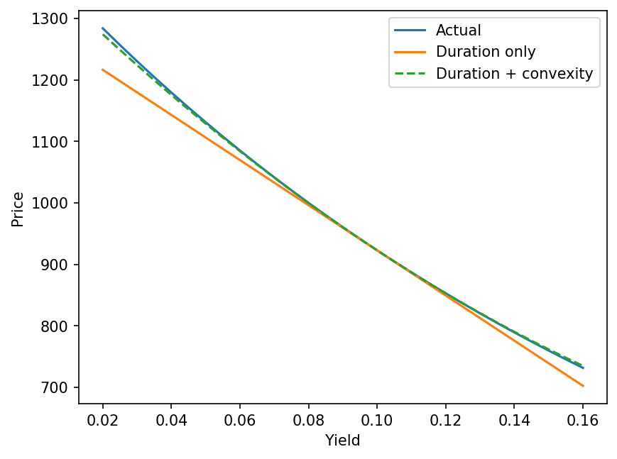

# Bond Valuation & Interest-Rate Risk Toolkit

Python toolkit for pricing fixed-rate bonds and measuring interest-rate risk.

## Features
- Bond price from coupon, maturity and yield
- Yield to maturity (bisection)
- Macaulay and modified duration
- Convexity, with duration vs duration+convexity vs actual repricing
- Clean/dirty price and accrued interest (30/360)

## Formulas
- Price = sum of coupons and face discounted at yield/freq
- Modified duration = Macaulay / (1 + y/freq)
- dP/P ≈ -ModDur·dy + ½·Convexity·dy²

## Assumptions
- Flat yield, fixed-rate bonds, 30/360 day count
- Face value repaid at maturity

## Worked example

Face 1000, 8% coupon, 5 years, 10% yield, semiannual:
price 922.78, modified duration 3.98, convexity 19.57.
At +200 bps: duration-only error -3.48, duration+convexity error 0.13.

## Verification
Results checked against Excel (PV, RATE, DURATION, MDURATION, ACCRINT) and 8 edge-case tests.

## Run it
Requires: pandas, matplotlib, ipywidgets
Open `07_demo.ipynb` in Jupyter.

## Limitations
No call/put features, no floating-rate bonds, 30/360 assumed only.

